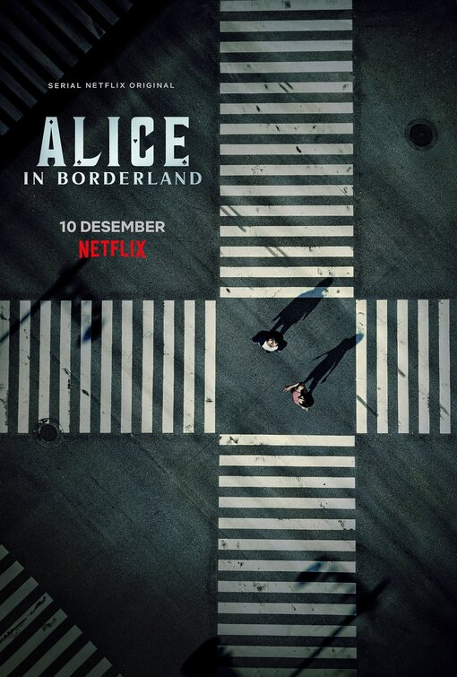

# Alice in Borderland

## Short Description

Alice in Borderland is a Japanese science-fiction, survival thriller and mystery web series based on the manga written by Haro Aso.

The story follows Ryohei Arisu, a young man who suddenly finds himself in a mysterious and abandoned version of Tokyo called the Borderland. Along with other survivors, he must participate in dangerous games that test intelligence, physical strength, teamwork and psychological abilities.

Each game has its own rules and difficulty level, represented by playing cards. Players must win these games to extend their visas and continue surviving.

Throughout the series, Arisu meets several characters, including Yuzuha Usagi, Shuntaro Chishiya and Hikari Kuina. Together, they face dangerous challenges while trying to understand the mystery behind the Borderland.

## Basic Information

- **Series Name:** Alice in Borderland
- **Original Name:** Imawa no Kuni no Arisu
- **Genre:** Science Fiction, Survival, Thriller, Action, Mystery
- **Country:** Japan
- **Original Language:** Japanese
- **Streaming Platform:** Netflix
- **Based On:** Manga by Haro Aso
- **Director:** Shinsuke Sato
- **Number of Seasons:** 3
- **First Release:** December 10, 2020
- **Season 3 Release:** September 25, 2025

## Main Highlights

- Survival games based on playing cards.
- Challenging puzzles and psychological battles.
- Interesting character development.
- Unexpected twists and mysteries.
- Themes of friendship, trust, sacrifice and survival.

## Official Platform

[Watch Alice in Borderland on Netflix](https://www.netflix.com/title/80200575)

---
**Note:** This is a fan-made informational project created for educational and GitHub learning purposes.